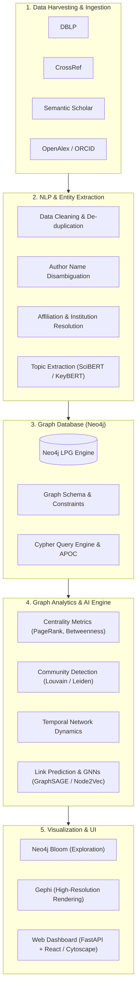
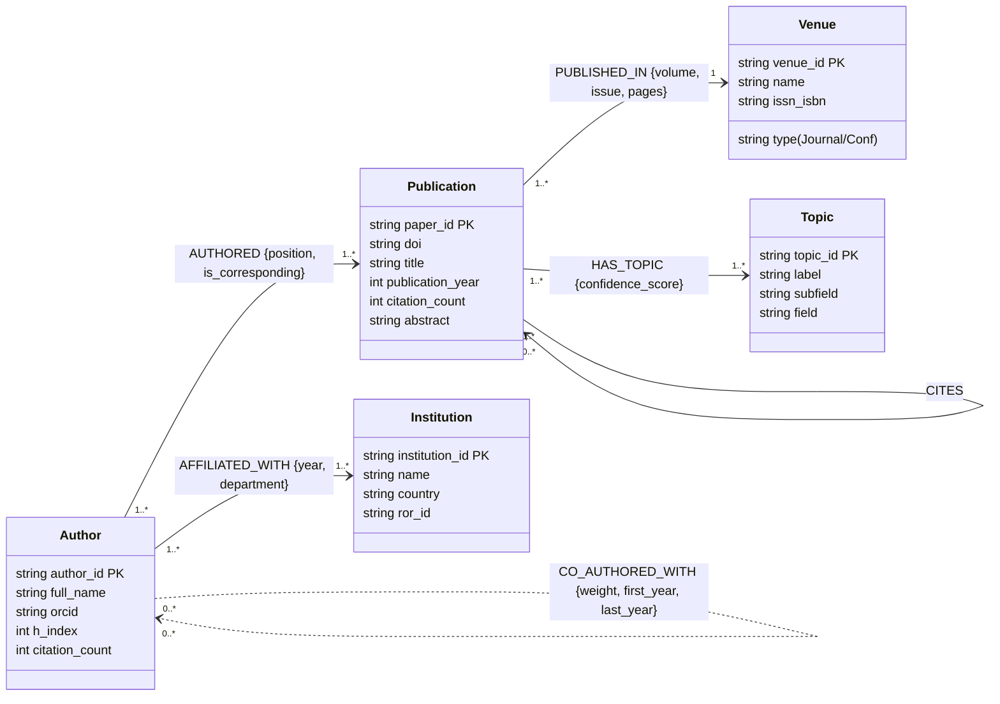

# MASTER PROJECT PLAN
## Project Title: Graph-Based Knowledge Graph for Research Collaboration Analysis

---

## 1. Executive Summary & Project Overview

### 1.1 Context & Problem Statement
The exponential growth of scholarly literature across disciplines makes it increasingly difficult to track collaboration networks, discover interdisciplinary research opportunities, and identify influential researchers or emerging topics. 

Conventional bibliometrics and co-authorship networks predominantly model simple pairwise author-to-author relationships (homogeneous graphs). This pairwise representation fails to capture the multifaceted, heterogeneous, and semantic nature of academic ecosystems—in which researchers are embedded in institutions, publish across venues, cite prior literature, and explore evolving research topics.

### 1.2 Proposed Solution
This project develops an end-to-end **Graph-Based Knowledge Graph (KG) for Research Collaboration Analysis**. By modeling research entities (Authors, Publications, Institutions, Topics, Venues) as a heterogeneous labeled property graph in **Neo4j**, the system enables:
1. **Multi-Entity Semantic Modeling:** Rich representation of multi-hop relationships (`AUTHORED`, `AFFILIATED_WITH`, `PUBLISHED_IN`, `HAS_TOPIC`, `CITES`).
2. **Community & Influence Analytics:** Identification of collaborative clusters and key academic gatekeepers using Louvain/Leiden community detection and centrality metrics (PageRank, Betweenness).
3. **AI-Driven Collaborator Recommendation:** Link prediction powered by Graph Embeddings (Node2Vec, FastRP) and Graph Neural Networks (GraphSAGE, GAT).
4. **Interactive Exploration & Decision Support:** High-fidelity interactive dashboards (Neo4j Bloom, Gephi, and a custom Web UI) tailored for researchers, universities, and funding agencies.

---

## 2. System Architecture & Ontology Design

### 2.1 End-to-End System Architecture



---

### 2.2 Knowledge Graph Schema (Ontology)



---

## 3. Three-Semester Roadmap (Semester-wise Breakdown)

### Phase I: Project - I (Semester 1)
**Theme:** *Foundation, Literature Review, Data Pipeline, NLP Extraction & Schema Design*

#### Objective
Establish theoretical foundations, harvest and clean bibliographic datasets, disambiguate academic entities, extract research domains using NLP, and implement the graph database schema in Neo4j.

#### Detailed Work Breakdown
1. **Literature Survey & Benchmark Framing (Weeks 1–4)**
   - Systematic review of academic knowledge graphs (OpenAlex, Microsoft Academic Graph, Open Research Knowledge Graph).
   - Analysis of state-of-the-art author name disambiguation (AND) and academic link prediction techniques.
   - Formalize research questions, evaluation hypotheses, and target academic domain (e.g., AI/Machine Learning, 2016–2025).

2. **Data Acquisition & Harvesting Pipeline (Weeks 5–7)**
   - Set up API harvesters with rate limiting and exponential backoff for **OpenAlex**, **Semantic Scholar Graph API**, **CrossRef**, and **DBLP**.
   - Build a pilot dataset (500–1,000 papers) to validate metadata completeness (DOIs, abstracts, affiliations, citation lists).
   - Scale collection to a full corpus target of 10,000–50,000 publications.

3. **Preprocessing & NLP Entity Extraction (Weeks 8–10)**
   - **Author Name Disambiguation (AND):** Resolve homonyms (different researchers with identical names) and synonyms (same researcher with alternate spellings) using ORCID, co-authorship overlap, and institution signals.
   - **Affiliation Normalization:** Map free-text affiliations to canonical institutions via ROR (Research Organization Registry) IDs.
   - **Topic Modeling & Extraction:** Use pre-trained scientific NLP models (SciBERT / KeyBERT) to extract standardized keywords and research domains from abstracts and titles.

4. **Neo4j Graph Database Schema & Ingestion (Weeks 11–13)**
   - Implement labeled property graph constraints (Unique constraints on `author_id`, `paper_id`, `institution_id`).
   - Create indexing strategies for sub-second Cypher queries (text indexing on titles/names, temporal indexing on years).
   - Write reproducible bulk ingestion scripts (`neo4j-admin database import` / Cypher `APOC` periodic iterate).

5. **Project-I Review, Documentation & Defense (Weeks 14–16)**
   - Deliverable: Comprehensive Project-I Report, Database Schema Specification, Data Dictionary, and verified pilot graph instance.

---

### Phase II: Project - II (Semester 2)
**Theme:** *Graph Construction, Community Detection, Centrality Metrics & Collaboration Dynamics*

#### Objective
Construct the full-scale Knowledge Graph, compute network centrality measures to identify influential researchers, implement community detection algorithms (Louvain/Leiden), and analyze temporal collaboration patterns.

#### Detailed Work Breakdown
1. **Full-Scale Graph Construction & Quality Auditing (Weeks 1–3)**
   - Ingest the complete corpus into Neo4j; verify node and edge counts, relationship densities, and schema integrity.
   - Build projected homogeneous co-authorship graphs:
     $$\text{Weight}(A_i, A_j) = \sum_{p \in P(A_i, A_j)} \frac{1}{|Authors(p)| - 1}$$
   - Construct bipartite projections (Author-Topic, Author-Institution).

2. **Centrality Analysis & Influence Ranking (Weeks 4–6)**
   - Run Neo4j Graph Data Science (GDS) algorithms:
     - **PageRank:** Identifying authoritative researchers based on citation cascades and prestigious collaborations.
     - **Betweenness Centrality:** Spotting academic "brokers" connecting disjoint subfields.
     - **Degree & Closeness Centrality:** Quantifying direct reach and propagation efficiency.
     - **HITS (Hubs and Authorities):** Separating multidisciplinary connectors from domain specialists.

3. **Community Detection & Clustering (Weeks 7–9)**
   - Execute **Louvain Algorithm** for modularity optimization.
   - Implement the **Leiden Algorithm** to resolve Louvain’s disconnected community limitation and ensure well-partitioned clusters.
   - Extract semantic labels for detected communities using TF-IDF and KeyBERT on the publications within each cluster.

4. **Temporal Network Evolution (Weeks 10–12)**
   - Analyze temporal slicing (e.g., 2-year sliding windows from 2016 to 2025).
   - Track community birth, expansion, split, merge, and death (interdisciplinary fusion).
   - Identify cross-institutional collaboration growth trends over time.

5. **Advanced Graph Visualization & Project-II Report (Weeks 13–16)**
   - Generate visual layouts in **Gephi** (ForceAtlas2, OpenOrd) for high-resolution topology presentations.
   - Configure **Neo4j Bloom** perspective rules for interactive exploration by faculty and domain experts.
   - Deliverable: Project-II Report, Network Analytics Benchmark Suite, and Interactive Exploration Demo.

---

### Phase III: Project - III (Semester 3)
**Theme:** *AI Collaborator Recommendation, GNNs, Web Dashboard & Deployment*

#### Objective
Develop a collaborator recommendation engine using Graph Embeddings and Graph Neural Networks (GNNs), evaluate link prediction performance, build a web dashboard, and deploy the system.

#### Detailed Work Breakdown
1. **Graph Representation Learning (Embeddings) (Weeks 1–4)**
   - **Baseline Embeddings:** Train **Node2Vec** and **FastRP** (Fast Random Projection) to capture topological similarity between authors.
   - **Knowledge Graph Embeddings:** Benchmark **TransE** and **RotatE** for multi-relational link prediction ($Author \xrightarrow{CO\_AUTHORED} Author$).
   - Feature engineering: Combine structural graph embeddings with semantic profile vectors (SciBERT embeddings of publication abstracts).

2. **Graph Neural Networks (GNNs) for Link Prediction (Weeks 5–7)**
   - Construct heterogeneous graph datasets using **PyTorch Geometric (PyG)** or **DGL**.
   - Train a **Heterogeneous GraphSAGE** or **Graph Attention Network (GAT)** model to predict prospective co-authorship links.
   - Incorporate negative sampling strategies to handle network sparsity realistically.

3. **Comprehensive Evaluation & Benchmarking (Weeks 8–9)**
   - **Community Quality:** Modularity ($Q$), Conductance, Normalized Mutual Information (NMI).
   - **Recommendation Accuracy:** Precision@K, Recall@K, Mean Reciprocal Rank (MRR), ROC-AUC, and PR-AUC on temporally separated test data (e.g., train on 2016–2022, evaluate on 2023–2025).
   - Qualitative evaluation: Expert validation of top recommended interdisciplinary collaborators.

4. **Interactive Web Dashboard Development (Weeks 10–12)**
   - **Backend:** FastAPI microservice interfacing with Neo4j via official Python driver and PyTorch inference engine.
   - **Frontend:** Streamlit or React/Next.js with Cytoscape.js / PyVis for real-time ego-network visualization.
   - **Key Features:**
     - Search author / institution / topic.
     - Visual exploration of collaboration clusters.
     - "Find Future Collaborator" recommendation engine with explainable match rationales (shared topics, common intermediaries).

5. **System Optimization, Packaging & Deployment (Weeks 13–14)**
   - Containerize full stack with Docker Compose (`neo4j`, `backend-api`, `frontend-ui`).
   - Optimize query latency via GDS memory configuration and result caching (Redis).

6. **Final Thesis, Documentation & Project Defense (Weeks 15–16)**
   - Compile comprehensive final thesis and reproducible code repository.
   - Prepare presentation slides, live demo, and research paper draft for submission.

---

## 4. Evaluation Framework & Metrics

| Category | Metric | Evaluation Purpose | Target Benchmark |
|---|---|---|---|
| **Graph Partitioning** | **Modularity ($Q$)** | Measure the strength of division of a network into communities. | $Q \ge 0.65$ |
| **Cluster Cohesion** | **Conductance / Silhouette** | Assess cluster separation and internal cohesion. | Low conductance ($<0.25$) |
| **Link Prediction** | **ROC-AUC & PR-AUC** | Evaluate ability to rank true future collaborations over non-collaborations. | $\text{ROC-AUC} \ge 0.85$ |
| **Recommendation** | **Hits@10 & Precision@10** | Measure whether relevant collaborators appear in the top-10 recommended list. | $\text{Hits@10} \ge 0.60$ |
| **Ranking Quality** | **MRR (Mean Reciprocal Rank)** | Position of first relevant collaborator recommendation. | $\text{MRR} \ge 0.50$ |
| **System Latency** | **Query Response Time** | Interactive graph search and ego-network retrieval response time. | $< 1.2 \text{ seconds}$ |

---

## 5. Technology Stack

```
+--------------------------------------------------------------------------+
| Layer                   | Tools / Technologies                           |
+--------------------------------------------------------------------------+
| Primary Language        | Python 3.10+                                   |
| Graph Database          | Neo4j Enterprise / Community 5.x, Cypher, APOC |
| Graph Data Science      | Neo4j GDS Library, NetworkX, igraph, Gephi     |
| NLP & Embeddings        | HuggingFace Transformers, SciBERT, KeyBERT     |
| Graph Machine Learning  | PyTorch Geometric (PyG), DGL, Node2Vec         |
| Backend API             | FastAPI, Uvicorn, Pydantic                     |
| Frontend UI             | Streamlit / React (Cytoscape.js, PyVis)        |
| Data Harvesting         | OpenAlex API, CrossRef REST API, Semantic      |
|                         | Scholar API, Requests, BeautifulSoup           |
| DevOps & Container      | Docker, Docker Compose, Git / GitHub           |
+--------------------------------------------------------------------------+
```

---

## 6. Risk Management & Contingency Plan

| Risk Description | Probability | Impact | Mitigation Strategy |
|---|---|---|---|
| **Author Name Ambiguity:** Duplicate authors or authors sharing common names corrupting graph edges. | High | High | Implement multi-factor disambiguation (ORCID identifiers + institution affiliation + co-author neighbourhood similarity). Avoid name-only merging. |
| **Graph Scalability & Memory Limits:** Memory exhaustion during graph embedding or GNN training on large networks. | Medium | High | Utilize Neo4j GDS in-memory graph projections with native filtering. Use neighborhood sampling (GraphSAGE) rather than full-batch GNN training. |
| **Data Sparsity in Topic/Affiliation:** Missing fields in public bibliographic APIs. | Medium | Medium | Use OpenAlex as the primary backbone (high metadata completeness). Fall back to SciBERT-based keyword extraction for papers lacking explicit author keywords. |
| **API Rate Limits / Outages:** Disruption during large-scale bibliographic scraping. | Low | Medium | Implement caching, polite pool headers, local JSON staging, and cursor pagination. |

---

## 7. Immediate Next Steps (Sprint 1 Action Items)

- [ ] **Step 1:** Finalize the research scope, topic boundary (e.g., AI/ML publications), and target publication year window (2016–2025).
- [ ] **Step 2:** Set up the local development environment (Python virtual environment, Neo4j 5.x Desktop / Docker instance).
- [ ] **Step 3:** Develop the pilot harvesting script using OpenAlex / CrossRef API to download and inspect 500 candidate publications.
- [ ] **Step 4:** Execute the pilot cleaning pipeline and verify entity fields (`author_id`, `work_id`, `institution_id`, `doi`, `topics`).
- [ ] **Step 5:** Write the initial Neo4j Cypher schema constraints and load the pilot graph.
