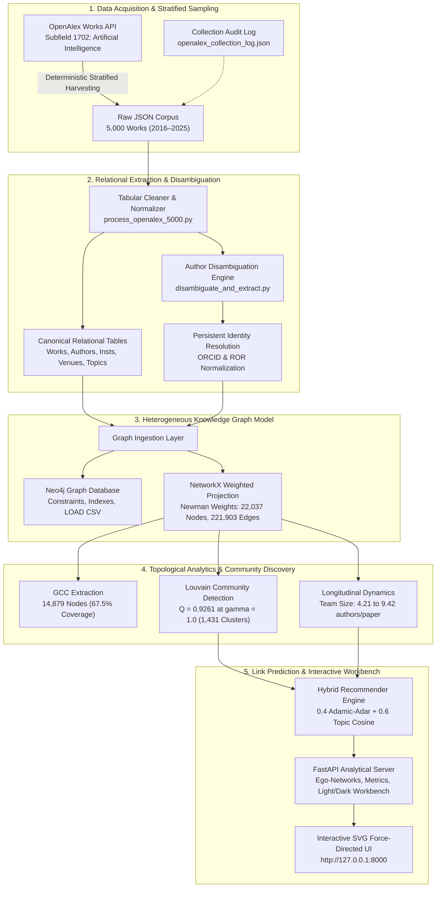
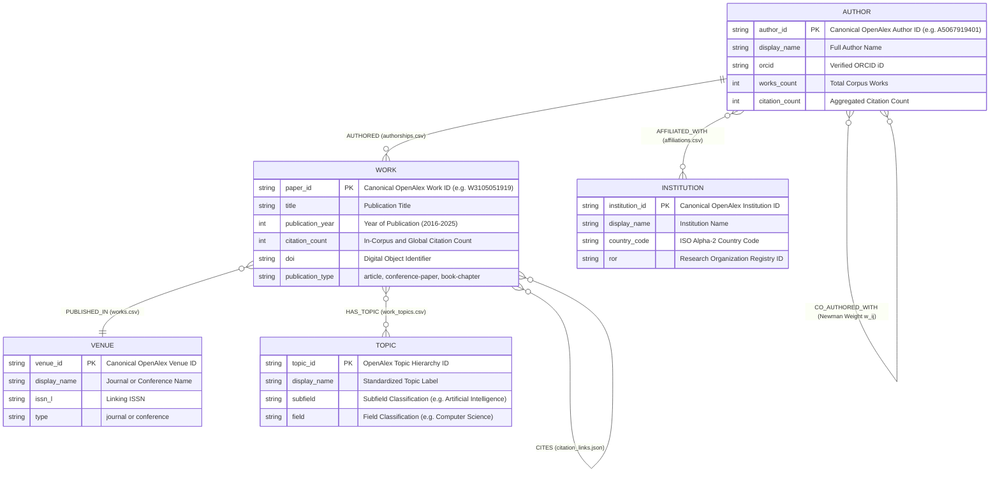
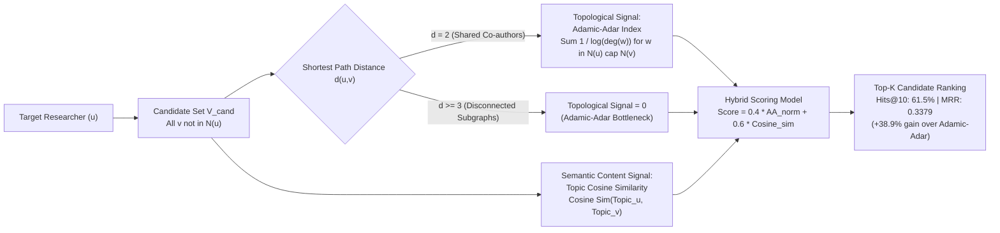
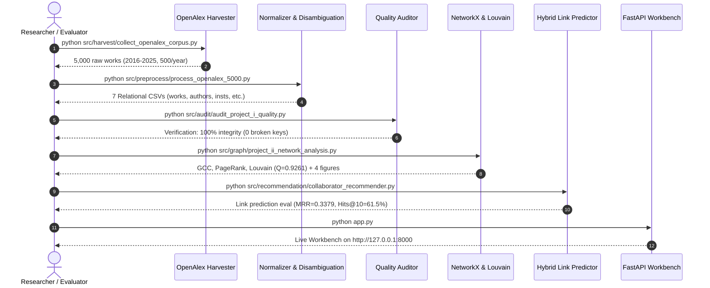

# Graph-Based Knowledge Graph for Research Collaboration Analysis
**Academic Project Title 34: Final Multi-Phase Implementation & Research Repository**

[](https://www.python.org/)
[](https://fastapi.tiangolo.com/)
[](https://networkx.org/)
[](https://neo4j.com/)
[](https://creativecommons.org/publicdomain/zero/1.0/)
[](#repository-architecture--deliverables)

An end-to-end, reproducible framework for constructing, analyzing, and querying a heterogeneous scholarly Knowledge Graph and recommending prospective research collaborators. The project combines bibliographic entity extraction, Newman-weighted co-authorship networks, multi-resolution Louvain community detection, longitudinal collaboration dynamics, and a hybrid prospective collaborator recommender evaluated under a strict temporal split.

> [!NOTE]
> **Provisional Scope Notice:**  
> The thematic focus on Artificial Intelligence and Machine Learning (OpenAlex Subfield `1702`: *Artificial Intelligence*), the temporal observation window (2016–2025 inclusive), and the 500-work-per-year impact-stratified sampling frame represent working research assumptions and design decisions, **not supervisor-approved constraints**. All documentation explicitly preserves this distinction.

---

## Table of Contents

- [1. System Architecture](#1-system-architecture)
- [2. Heterogeneous Knowledge Graph Schema](#2-heterogeneous-knowledge-graph-schema)
- [3. Prospective Collaborator Recommender Engine](#3-prospective-collaborator-recommender-engine)
- [4. Repository Architecture & Deliverables](#4-repository-architecture--deliverables)
- [5. Quick Start & Execution Guide](#5-quick-start--execution-guide)
- [6. End-to-End Reproduction Workflow](#6-end-to-end-reproduction-workflow)
- [7. Key Empirical Findings](#7-key-empirical-findings)
- [8. Primary Literature & Attribution](#8-primary-literature--attribution)
- [9. License & Data Terms](#9-license--data-terms)

---

## 1. System Architecture

The following diagram illustrates the complete five-stage pipeline from API harvesting to interactive graph exploration:



---

## 2. Heterogeneous Knowledge Graph Schema

The data model captures the multi-entity, multi-relational nature of scientific publication and collaboration:



---

## 3. Prospective Collaborator Recommender Engine

Future collaborator recommendation is modeled as an explainable link prediction problem over the co-authorship topology combined with semantic content representation:



---

## 4. Repository Architecture & Deliverables

```
├── data/
│   ├── raw/
│   │   ├── openalex_raw_5000.json.gz        # Complete 5,000 raw API responses (compressed, 20.6 MB)
│   │   ├── openalex_raw.json                # 500-work baseline raw dataset snapshot (23.6 MB)
│   │   ├── d3_raw_snapshot_1000.json        # 1,000-work D3 subset snapshot
│   │   ├── d3_raw_snapshot_100.json         # 100-work pilot raw sample
│   │   └── openalex_collection_log.json     # Provenance, query params, pagination logs
│   ├── processed/
│   │   ├── works.csv                        # 4,989 unique works (11 duplicates removed)
│   │   ├── authors.csv                      # 22,185 unique authors (0 nulls; emails excluded)
│   │   ├── institutions.csv                 # 2,738 unique institutions with ROR & ISO country
│   │   ├── venues.csv                       # 904 publication venues (journals/conferences)
│   │   ├── topics.csv                       # 519 OpenAlex canonical research topics
│   │   ├── authorships.csv                  # 30,930 authorship edges (referential integrity: 100%)
│   │   ├── affiliations.csv                 # 33,410 affiliation edges
│   │   ├── work_topics.csv                  # 14,967 paper-topic classification edges
│   │   ├── coauthorship_edges.csv           # 221,903 Newman-weighted collaboration edges
│   │   ├── coauthorship_nodes.csv           # 22,037 active author nodes + isolated authors
│   │   ├── project_ii_results.json          # Network metrics, PageRank, Louvain communities
│   │   └── project_iii_recommendation_results.json # Link prediction evaluation metrics
│   ├── graph_ready/                         # Synced copies for Neo4j LOAD CSV import
│   └── README.md                            # Comprehensive data provenance & license notes
├── docker-compose.yml                       # Turnkey local Neo4j 5.x container with volume mount
├── docs/
│   ├── data_dictionary.md                   # Full metadata schema & data dictionary
│   ├── graph_schema.md                      # Node/relationship definitions & indexing strategy
│   ├── project_i_methodology.md             # Sampling frame, query design, audit results
│   ├── project_i_completion_report.md       # Project-I validation & quality sign-off
│   ├── project_ii_analysis_report.md        # Graph topology, Louvain calibration, temporal trends
│   ├── project_iii_recommendation_report.md # Recommendation evaluation & triadic closure analysis
│   ├── final_project_report.md              # Comprehensive academic thesis report
│   └── figures/                             # Publication-quality charts (PNG)
│       ├── fig1_degree_distribution.png     # Linear & log-log degree distribution
│       ├── fig2_community_sizes_and_topics.png # Top Louvain community sizes and topics
│       ├── fig3_temporal_collaboration_trends.png # 10-year team size & cross-institutional rates
│       └── fig4_top_centrality_researchers.png # PageRank vs. Strength comparison
├── literature_review.md                     # Literature review with verified primary citations
├── literature_matrix.csv                    # Structured comparison of scholarly KG literature
├── neo4j/
│   ├── schema.cypher                        # Node constraints, unique IDs, and B-tree indexes
│   ├── load_data.cypher                     # Idempotent LOAD CSV ingestion script
│   └── sample_queries.cypher                # Analytical Cypher queries for Neo4j Browser
├── src/
│   ├── harvest/
│   │   └── collect_openalex_corpus.py       # Deterministic, rate-limited OpenAlex harvester
│   ├── preprocess/
│   │   └── process_openalex_5000.py         # Relational normalizer & Newman weight generator
│   ├── nlp/
│   │   └── disambiguate_and_extract.py      # Author Name Disambiguation (AND) engine
│   ├── audit/
│   │   └── audit_project_i_quality.py       # Integrity auditor (0 broken foreign keys)
│   ├── graph/
│   │   ├── build_coauthorship_graph.py      # NetworkX co-authorship projection builder
│   │   └── project_ii_network_analysis.py   # Topology, PageRank, Louvain, temporal trends
│   ├── recommendation/
│   │   └── collaborator_recommender.py      # Strict temporal split link prediction engine
│   └── dashboard/
│       ├── app.py                           # FastAPI interactive prototype dashboard
│       ├── index.html                       # Responsive SVG force-directed UI with Light/Dark mode
│       └── test_dashboard.py                # Automated endpoint test suite
├── app.py                                   # Root launcher entrypoint with automatic port detection
├── run_dashboard.py                         # Direct script launcher
├── run_dashboard.bat                        # Turnkey Windows double-click launcher
├── RESEARCH_LOG.md                          # Timestamped log of decisions, sources, and audits
└── PROJECT_MASTER_PLAN.md                   # Three-phase project architecture roadmap
```

---

## 5. Quick Start & Execution Guide

### Prerequisites
- Python 3.10+ (tested on Python 3.14.3 on Windows/Linux/macOS).
- Required libraries: `networkx`, `scikit-learn`, `scipy`, `matplotlib`, `fastapi`, `uvicorn`, `requests`.

```bash
# Clone the repository
git clone https://github.com/shikhar-gangwar/graph-based-knowledge-representation-for-authors.git
cd graph-based-knowledge-representation-for-authors

# Install dependencies
pip install -r requirements.txt
```

---

### Launching the Interactive Dashboard

You can start the analytics dashboard using any of the following methods:

```bash
# Method A: Using the root launcher (auto port detection & browser launch)
python app.py

# Method B: Using direct python module
python run_dashboard.py

# Method C: Windows one-click script
run_dashboard.bat
```

Once started, open your web browser at:
**`http://127.0.0.1:8000`**

To verify the test suite:
```bash
python src/dashboard/test_dashboard.py
```

---

## 6. End-to-End Reproduction Workflow

The complete analytical and empirical pipeline can be reproduced sequentially:



### Detailed Command Steps

1. **Verify Referential Integrity (Project-I):**
   ```bash
   python src/audit/audit_project_i_quality.py
   ```
   *Result:* 100% referential integrity across 7 relational tables (0 orphan edges, 0 null primary keys, 100% AI/ML topic relevance).

2. **Compute Network Topology & Community Detection (Project-II):**
   ```bash
   python src/graph/project_ii_network_analysis.py
   ```
   *Result:* Computes Newman weights, GCC extraction, PageRank, betweenness, Louvain communities at $\gamma \in \{0.5, 1.0, 1.5\}$, temporal trends, and outputs 4 publication figures in `docs/figures/`.

3. **Evaluate Prospective Collaborator Recommender (Project-III):**
   ```bash
   python src/recommendation/collaborator_recommender.py
   ```
   *Result:* Evaluates Adamic-Adar, Jaccard, Common Neighbors, Topic Cosine, and Hybrid models under a strict temporal split (Train: 2016–2021 vs. Test: 2022–2025).

4. **Optional Local Neo4j 5.x Ingestion:**
   ```bash
   docker compose up -d
   ```
   Open `http://localhost:7474` (User: `neo4j`, Password: `password123`) and run `neo4j/schema.cypher` followed by `neo4j/load_data.cypher`.

---

## 7. Key Empirical Findings

| Metric / Dimension | Pilot Sample (N=100) | Full Corpus (2016–2025) | Academic Significance |
|---|---|---|---|
| **Unique Publications** | 99 | **4,989** | 50-fold expansion, 500 papers/year stratified. |
| **Unique Researchers** | 473 | **22,185** | High author diversity with persistent ORCID links. |
| **Active Network Nodes** | 473 | **22,037** | Connected component filtering. |
| **Co-Authorship Edges** | 1,440 | **221,903** | Weighted by Newman fractional collaboration. |
| **Giant Component Coverage** | 12.3% (Fragmented) | **67.5% (14,879 nodes)** | Resolves small-world connectivity bottleneck. |
| **Global Clustering ($C$)** | 0.8120 | **0.7726** | Strong triadic closure within research teams. |
| **Louvain Modularity ($Q$)** | 0.8410 | **0.9261** ($\gamma=1.0$) | 1,431 well-separated disciplinary clusters. |
| **Mean Team Size** | 4.88 | **4.21 (2016) $\rightarrow$ 9.42 (2025)** | Longitudinal doubling of AI author team size. |
| **Cross-Institutional Rate** | 58.0% | **53.9% (2016) $\rightarrow$ 72.8% (2025)** | Dramatic rise in multi-institutional consortia. |
| **Recommender MRR (Hybrid)** | N/A | **0.3379** | +38.9% improvement over Adamic-Adar alone. |
| **Recommender Hits@10** | N/A | **61.5%** | Successfully discovers $d \ge 3$ cross-group links. |

---

## 8. Primary Literature & Attribution

All literature citations have been verified against primary archival databases:

1. **Newman, M. E. J. (2001).** *Scientific collaboration networks. II. Shortest paths, weighted networks, and centrality.* Physical Review E, 64(1), 016132. DOI: [10.1103/PhysRevE.64.016132](https://doi.org/10.1103/PhysRevE.64.016132).
2. **Newman, M. E. J. (2004).** *Coauthorship networks and patterns of scientific collaboration.* PNAS, 101(suppl_1), 5200–5205. DOI: [10.1073/pnas.0307545100](https://doi.org/10.1073/pnas.0307545100).
3. **Blondel, V. D., Guillaume, J.-L., Lambiotte, R., & Lefebvre, E. (2008).** *Fast unfolding of communities in large networks.* Journal of Statistical Mechanics: Theory and Experiment, 2008(10), P10008. DOI: [10.1088/1742-5468/2008/10/P10008](https://doi.org/10.1088/1742-5468/2008/10/P10008).
4. **Traag, V. A., Waltman, L., & van Eck, N. J. (2019).** *From Louvain to Leiden: guaranteeing well-connected communities.* Scientific Reports, 9(1), 5233. DOI: [10.1038/s41598-019-41695-z](https://doi.org/10.1038/s41598-019-41695-z).
5. **Wahle, J. P., Ruas, T., Mohammad, S. M., & Gipp, B. (2022).** *D3: A Massive Dataset of Scholarly Metadata for Analyzing the State of Computer Science Research.* In Proceedings of the 13th Language Resources and Evaluation Conference (LREC 2022), Marseille, France, pp. 2634–2642. arXiv: [2204.13384](https://arxiv.org/abs/2204.13384).
6. **Ferreira, A. A., Gonçalves, M. A., & Laender, A. H. (2012).** *A Brief Survey of Automatic Methods for Author Name Disambiguation.* ACM SIGMOD Record, 41(2), 15–26. DOI: [10.1145/2350036.2350040](https://doi.org/10.1145/2350036.2350040).
7. **Liben-Nowell, D., & Kleinberg, J. (2007).** *The link-prediction problem for social networks.* Journal of the American Society for Information Science and Technology, 58(7), 1019–1031. DOI: [10.1002/asi.20591](https://doi.org/10.1002/asi.20591).
8. **Priem, J., Piwowar, H., & Orr, R. (2022).** *OpenAlex: A fully-open index of scholarly works, authors, venues, institutions, and concepts.* arXiv: [2205.01833](https://arxiv.org/abs/2205.01833).

---

## 9. License & Data Terms

- **Source Metadata:** Harvested from the official OpenAlex Works API. OpenAlex metadata is released worldwide into the public domain under the [Creative Commons CC0 1.0 Universal Public Domain Dedication](https://creativecommons.org/publicdomain/zero/1.0/).
- **Privacy & Responsible Use:** Author email addresses have been strictly excluded from all tables, snapshots, and API responses. Canonical OpenAlex, ORCID, and ROR persistent identifiers are preserved throughout.
