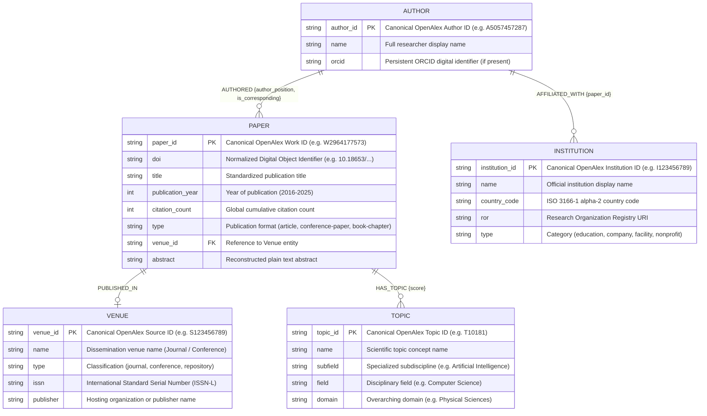

# Knowledge Graph Database Schema Specification
## Project: Graph-Based Knowledge Graph for Research Collaboration Analysis
**Academic Phase:** Project - I  
**Target Graph Database:** Neo4j 5.x (Community or Enterprise)  
**Data Model:** Labeled Property Graph (LPG)  

---

## 1. Entity-Relationship & Schema Diagram

---

## 2. Node Entity Definitions

### 2.1 `Paper`
Represents an individual scholarly contribution (journal article, conference proceeding, or book chapter).
- **Primary Key:** `paper_id` (String, e.g. `W2964177573`)
- **Properties:**
  - `doi` (String, nullable): Normalized DOI string without URL prefixes.
  - `title` (String, not null): Standardized, cleaned paper title.
  - `publication_year` (Integer, not null): Validated range $[2016, 2025]$.
  - `citation_count` (Integer, not null): Non-negative integer.
  - `type` (String, not null): Publication classification.
  - `abstract` (String, nullable): Cleaned prose reconstructed from inverted index.
  - `venue_id` (String, nullable): Foreign reference to the publication source.

### 2.2 `Author`
Represents a researcher.
- **Primary Key:** `author_id` (String, e.g. `A5057457287`)
- **Properties:**
  - `name` (String, not null): Display name.
  - `orcid` (String, nullable): Official persistent digital identifier.
- **Privacy Enforcement:** Author email addresses are **completely excluded** by design.

### 2.3 `Institution`
Represents academic universities, government institutes, or industrial research labs.
- **Primary Key:** `institution_id` (String, e.g. `I123456789`)
- **Properties:**
  - `name` (String, not null): Full canonical institutional name.
  - `country_code` (String, nullable): Two-letter ISO country code.
  - `ror` (String, nullable): Global Research Organization Registry identifier.
  - `type` (String, nullable): Sector classification.

### 2.4 `Venue`
Represents publishing outlets.
- **Primary Key:** `venue_id` (String, e.g. `S123456789`)
- **Properties:**
  - `name` (String, not null): Name of the journal or conference proceedings.
  - `type` (String, nullable): Publishing channel type.
  - `issn` (String, nullable): Standard serial number.
  - `publisher` (String, nullable): Host organization.

### 2.5 `Topic`
Represents scientific domains, subfields, and granular research topics from the OpenAlex topic taxonomy.
- **Primary Key:** `topic_id` (String, e.g. `T10181`)
- **Properties:**
  - `name` (String, not null): Topic label.
  - `subfield` (String, not null): Subfield (e.g. `Artificial Intelligence`).
  - `field` (String, not null): Field (e.g. `Computer Science`).
  - `domain` (String, not null): Domain (e.g. `Physical Sciences`).

---

## 3. Relationship (Edge) Specifications

### 3.1 `(:Author)-[:AUTHORED]->(:Paper)`
- **Cardinality:** Many-to-Many ($M:N$)
- **Properties:**
  - `author_position` (Integer): 1-based order of authorship (1 for lead author).
  - `is_corresponding` (Boolean): Whether the researcher is the designated corresponding contact.

### 3.2 `(:Author)-[:AFFILIATED_WITH]->(:Institution)`
- **Cardinality:** Many-to-Many ($M:N$)
- **Properties:**
  - `paper_id` (String): Provenance paper ID during which this affiliation was active.

### 3.3 `(:Paper)-[:PUBLISHED_IN]->(:Venue)`
- **Cardinality:** Many-to-One ($N:1$)
- **Properties:** None.

### 3.4 `(:Paper)-[:HAS_TOPIC]->(:Topic)`
- **Cardinality:** Many-to-Many ($M:N$)
- **Properties:**
  - `score` (Float): OpenAlex semantic assignment confidence score (range $[0.0, 1.0]$).

---

## 4. Design Rationale

1. **Labeled Property Graph vs. Flat RDF:** Neo4j's Labeled Property Graph (LPG) allows storing provenance attributes (such as `author_position` and topic `score`) directly on edges without complex RDF reification.
2. **Authority Control via Persistent IDs:** Using OpenAlex entity IDs (`W...`, `A...`, `I...`, `S...`, `T...`) and ROR URIs guarantees cross-source join stability and prevents duplicate entity explosion.
3. **Multi-Entity Heterogeneity:** Preserving explicit nodes for institutions and venues enables multi-hop traversal queries (e.g. finding which university departments co-publish in flagship AI conferences) that homogeneous co-authorship networks cannot answer.
